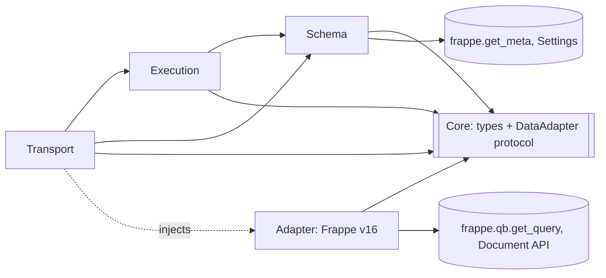
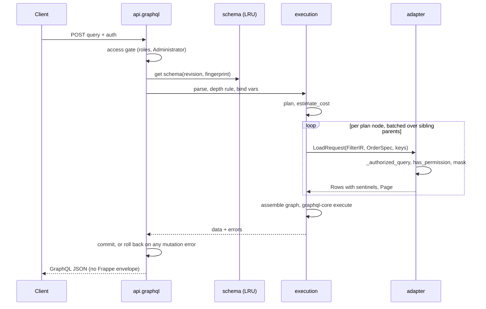
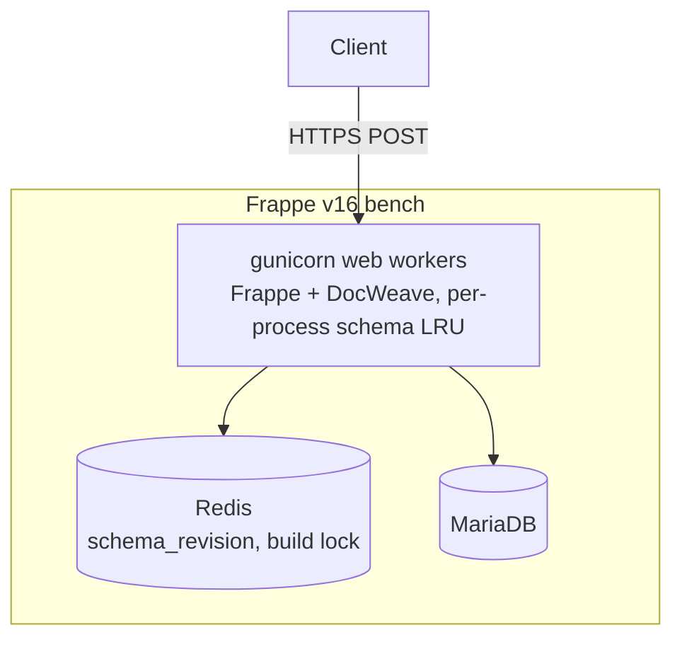

# Architecture Spine: DocWeave

## Design Paradigm

**Hexagonal (ports and adapters), with two-phase execution.** GraphQL is the inbound side and Frappe v16 is the outbound side. A dependency-free **core** owns every type the layers exchange.

| Layer | Package | Owns |
| --- | --- | --- |
| Core (shared kernel) | `docweave/core/` | Sentinels (`MASKED`, `FORBIDDEN`, `NOT_FOUND`), the `ErrorCode` enum, `FilterIR`, `OrderSpec`, `LoadRequest`, `Row`, `Page`, the `DataAdapter` protocol, the generic resolver. It imports nothing from DocWeave or Frappe. |
| Transport | `docweave/api.py` | HTTP endpoint, access gate, the transaction (sole commit/rollback owner), response writing |
| Schema | `docweave/schema/` | Names, the fieldtype map, building the `GraphQLSchema` from Settings plus meta, the cache |
| Execution | `docweave/execution/` | Depth rule, planner, cost, result-graph assembly, `graphql-core` execution, mutation dispatch |
| Adapter | `docweave/adapter/` | The **only** code that reads or writes Frappe data: permissions, masking, cursors, writes |
| Configuration | `docweave/docweave/doctype/` | DocWeave Settings (Single) and its child table |



Arrows are the only allowed import directions. `execution` never imports `adapter`. The transport injects the adapter instance.

## Invariants & Rules

### AD-1: Hexagonal boundary, enforced by allowlist [ADOPTED]

- **Binds:** all, NFR-1
- **Prevents:** data paths that bypass permissions, scattered across layers.
- **Rule:**
  - `docweave/tests/test_boundaries.py` walks the AST of every module. Outside `adapter/`, any `frappe.*` use must be on an allowlist: `get_meta`, `whitelist`, `cache`, `logger`, `log_error`, `_`, `session.user`, `get_roles`, `local.request`, `local.response`, `db.after_commit`, `db.rollback` (in `api.py` only), `clear_cache`. Aliased imports of these names are resolved.
  - Inside `adapter/`, data reads go only through `_authorized_query` (AD-2) and writes only through `adapter/writes.py` (AD-9).
  - `frappe.db.sql`, `frappe.db.exists`, `frappe.db.get_value`, `frappe.get_all`, `frappe.get_list` and `frappe.get_cached_doc` are banned everywhere.

### AD-2: Single authorized read chokepoint [ADOPTED]

- **Binds:** FR-6, FR-7, NFR-1
- **Prevents:** reads under Frappe's `ignore_permissions=True` default.
- **Rule:**
  - The signature is `adapter._authorized_query(doctype, *, fields, filter: FilterIR, order: OrderSpec, after: KeysetPosition | None, limit, parent_doctype=None, parentfield=None, parent_names=None)`.
  - It calls `frappe.qb.get_query` with `user=frappe.session.user`, `ignore_permissions=False`, `ignore_user_permissions=False`, and runs the query so that Frappe's masking applies.
  - The parameter set is closed: no `**kwargs`, no raw SQL, no Frappe-format filters accepted from callers.

### AD-3: Two-phase execution; resolvers do no I/O [ADOPTED]

- **Binds:** FR-4, FR-5
- **Prevents:** N+1 queries, resolvers that fetch data, and merged loads.
- **Rule:**
  - A query runs as: parse, depth rule, bind variables, **plan**, cost check (AD-10), **preload**, assemble the result graph, then `graphql-core` executes with `core`'s generic resolver.
  - The generic resolver reads the graph by **response key** (`info.path.key`, so aliases work) and converts sentinels into GraphQL errors.
  - A plan node's identity is `(DocType, parent_doctype, parentfield or link fieldname, argument fingerprint, path from root)`. Batching happens only across sibling parent rows of one node, never across nodes. The plan is a typed tree private to `execution`. The adapter receives only `LoadRequest`s.
  - Mutation root fields are the single exception: they call adapter write methods sequentially, then their selection set is planned and preloaded like a query (AD-9).

### AD-4: Two-stage authorization, with no per-candidate loads

- **Binds:** FR-5, FR-6, FR-8, NFR-1
- **Prevents:** missing document-level `has_permission` hooks, and an N+1 caused by checking them.
- **Rule:**
  - **Candidates** are rows from `_authorized_query`, already filtered by roles, User Permissions and `permission_query_conditions`.
  - The candidate query also fetches a **permission projection**: `name`, `owner`, `docstatus` and every non-table field. The adapter builds an unsaved document from that row (no DB load) and calls `frappe.has_permission(doctype, "read", doc=that_doc, user=user)`.
  - The projection is stripped before rows cross the port, unless a field was selected.
  - A query-count test asserts a constant number of queries per page.
  - Hooks see Frappe's mask placeholders for fields the user cannot unmask. This is a documented limitation with a test.

### AD-5: Masking and unreadable fields are metadata-driven

- **Binds:** FR-7
- **Prevents:** detecting masks by comparing strings, placeholder coercion crashes, and null-bubbling.
- **Rule:**
  - The adapter computes masked fields from `meta.get_masked_fields(parenttype=...)` (which already applies the DocPerm unmask setting) and readable fields from Frappe's permitted-fields logic for the user.
  - In `Row`, a masked value becomes the `MASKED` sentinel and a selected field the user cannot read at its permlevel becomes `FORBIDDEN`. The resolver emits `null` plus code `MASKED` or `FORBIDDEN`.
  - Every output field except `name` is nullable.

### AD-6: No filtering, sorting or derived loads from hidden data

- **Binds:** FR-4, FR-7, FR-8
- **Prevents:** leaking hidden values through filter, sort or link tricks.
- **Rule:**
  - Before any query runs, the adapter rejects with `FORBIDDEN` any `FilterIR` or `OrderSpec` field that is unreadable or masked for the user.
  - A Link (`xDoc`) or child table load starts only from a source field that is readable and unmasked for that row. Rows where the source is hidden get `xDoc` or the child list set to the same sentinel as the source field.
  - The planner reads keys only from masked `Row`s, never from raw data.

### AD-7: Links and children are authorized on their own

- **Binds:** FR-4, FR-7
- **Prevents:** inheriting access from a parent, and cross-table child leaks.
- **Rule:**
  - A Link target is loaded through AD-2 and AD-4 for its own DocType. Unreadable targets return `null` plus `NOT_FOUND` (AD-15).
  - The raw `x: String` follows the source field's readability, which matches Frappe desk and REST behaviour.
  - Child rows load only for parents that passed AD-4, with `parent_doctype`, `parentfield`, and `parent IN (authorized names)`, and only if the Table field is readable at its permlevel.
  - Children are ordered by `idx ASC` within each parent.

### AD-8: Cursor contract [ADOPTED, amended]

- **Binds:** FR-8, FR-9, FR-10
- **Prevents:** stalled pages, skipped or repeated rows, cursor replay, and cursors that leak hidden documents.
- **Rule:**
  - **Encoding.** The cursor is Fernet (AEAD) encrypted, never just signed. The key is derived with HKDF from the site encryption key, with purpose `docweave-cursor-v1`.
  - **Payload.** `{v, kid, iat, doctype, filter_hash, order, user, position}`. The current and the previous `kid` are both accepted. The TTL is 24 hours. A failure to decrypt, an expired cursor, or a mismatch in user, filter or order returns `BAD_CURSOR`.
  - **Keyset.**
    - The order is `OrderSpec` plus a `name` tie-break in the **same direction**. A missing `orderBy` resolves to `creation DESC, name DESC` before planning. The resolved order is always encoded, never `null`.
    - NULLs sort first in ASC and last in DESC, and the predicate includes an explicit `IS NULL` branch.
    - Values are encoded by type: Decimal as a string, Datetime as ISO 8601 with offset.
  - **Scanned** means *permission-checked*. The adapter fetches candidates in chunks. `position` is the last candidate that went through AD-4, never a fetched-but-unchecked row.
  - **Budget scope.** The scan budget applies per connection occurrence, counting only that connection's root candidates. A per-request `max_total_candidates` caps the total.
  - **Page info.**
    - When either budget is exhausted: `scanLimitReached: true`, `hasNextPage: true`, and a cursor even on an empty page.
    - `hasNextPage: false` only when the candidates are known to be exhausted.
    - `first` above the maximum page size is rejected with `VALIDATION` (no silent clamping).

### AD-9: Writes go through the Document API, all or nothing

- **Binds:** FR-11
- **Prevents:** partial commits, skipped validation, and overwriting hidden values.
- **Rule:**
  - `adapter/writes.py` uses `frappe.get_doc(...).insert()`, `.save()` and `frappe.delete_doc`. It never sets `ignore_permissions`, `ignore_validate` or `ignore_mandatory`, and it never commits.
  - **Transport owns the transaction.** If any mutation field errors, the whole request is rolled back and every mutation result is `null` with its error. Otherwise Frappe commits once.
  - Mutations run sequentially in document order.
  - **Update** is a sparse patch: only the provided fields change.
  - **Child tables in update.**
    - The input is the desired list of rows. A row with `name` patches that row, after the adapter verifies its `parent`, `parenttype` and `parentfield` match; otherwise `FORBIDDEN`. Hidden columns of patched rows are preserved.
    - A row without `name` is inserted. Existing rows left out are deleted.
  - **Payload.** A mutation returns `{ name, doc }`. `doc` is re-read through the normal planner (AD-3 to AD-7). If the user cannot read the result, `doc` is `null` with `NOT_FOUND`.

### AD-10: Request limits

- **Binds:** FR-12
- **Prevents:** unbounded queries, and limit checks that disagree with each other.
- **Rule:**
  - **Depth** is a `graphql-core` validation rule. `__schema` and `__type` subtrees are exempt, so standard introspection passes.
  - **Cost** is computed exactly once, by `execution.rules.estimate_cost(plan)`, after variables are bound and before any adapter call.
    - Rows per node: `first` for connections, the maximum page size if `first` is absent, `child_fanout_estimate` for child tables, and 1 for a Link.
    - Cost is the sum of rows × selected fields.
  - Limits come from DocWeave Settings. Breaches return `DEPTH_LIMIT` or `COST_LIMIT`, and the message names the limit and its value.

### AD-11: Schema is per site, versioned, never per user

- **Binds:** FR-1, FR-2, FR-13, FR-15
- **Prevents:** stale schemas, cache races, and per-user schemas.
- **Rule:**
  - The schema is built from Exposed DocTypes. Descriptions come from labels and help text.
  - **Revision.** `docweave:schema_revision` is a Redis integer, initialized to a random 64-bit value and incremented in `frappe.db.after_commit`. The bump handler calls `frappe.clear_cache(doctype=...)` first.
  - **Bump triggers.** DocWeave Settings, DocType, Custom Field, Property Setter, Customize Form, DocPerm and Custom DocPerm.
  - **Cache key.** `(revision, fingerprint)`. The fingerprint hashes Settings plus each exposed DocType's meta `modified` and Frappe's metadata version, which also catches hook-less Property Setter deletes.
  - **Storage.** The built `GraphQLSchema` lives in a per-process LRU. A Redis lock prevents several workers building at once.
  - Nullability never depends on permissions (AD-5), so permission changes need no rebuild beyond the triggers above.

### AD-12: Endpoint, access gate and response envelope

- **Binds:** FR-3, FR-14, PRD §2.2
- **Prevents:** CSRF bypass, guest or portal access, and leaks through Frappe's message envelope.
- **Rule:**
  - **Endpoints.** `@frappe.whitelist(methods=["POST"])` on `docweave.api.graphql`, with no guests. `docweave.api.sdl` is POST-only and limited to System Managers.
  - **Auth.** Frappe native: session with CSRF, API key and secret, or OAuth bearer.
  - **Access gate.** The endpoint is open only to users holding a role in Settings `allowed_roles`, which defaults to desk users and never includes Website Users. Otherwise it returns `NOT_EXPOSED`. Administrator is denied unless `allow_administrator` is enabled (default off).
  - **Response.**
    - The transport writes the GraphQL JSON body itself and clears `message_log`, so Frappe's `_server_messages`, `exc` and `message` envelope never appears.
    - HTTP status is 200 for GraphQL results with errors. Malformed requests get 400. Access-gate failures get 403 with `NOT_EXPOSED`.

### AD-13: Mutation input contract

- **Binds:** FR-11, NFR-1
- **Prevents:** writing protected or system fields, and taking over child rows.
- **Rule:**
  - **Generated input types exclude:** `owner`, `creation`, `modified`, `modified_by`, `docstatus`, `idx`, `parent`, `parenttype`, `parentfield`, `amended_from`, `workflow_state` and `_*`; `read_only` fields; `fetch_from` fields unless `fetch_if_empty`; virtual fields; Password and display fieldtypes; and `set_only_once` fields on update.
  - `name` is allowed on create only when autoname is Prompt.
  - **Request-time checks.** The adapter rejects with `FORBIDDEN` any field the user cannot write at its permlevel, or that is masked for them. It never relies on Frappe silently resetting the value.
  - **Submitted and cancelled documents.** Only `allow_on_submit` fields may change. Delete is refused.

### AD-14: Child DocTypes are never roots

- **Binds:** FR-1, FR-2
- **Prevents:** reading child rows without passing the parent's check.
- **Rule:**
  - Settings validation rejects `istable=1` DocTypes, and the builder asserts the same. Single DocTypes and DocWeave Settings are also never exposable.
  - Child types appear only under a parent's Table or Table MultiSelect field.
  - For child rows, the AD-4 check is the parent's check. No per-child `has_permission` call is made.

### AD-15: No existence disclosure; one exception map

- **Binds:** FR-14, NFR-1
- **Prevents:** existence oracles, and each module mapping errors differently.
- **Rule:**
  - A document unreadable through AD-2 or AD-4 is `NOT_FOUND`, whether or not it exists. `FORBIDDEN` is reserved for fields, filters, and writes to documents the caller can read.
  - `adapter/errors.py` is the only exception mapper:
    - `DoesNotExistError` becomes `NOT_FOUND`.
    - `PermissionError` becomes `FORBIDDEN` for writes on readable documents, otherwise `NOT_FOUND`.
    - `ValidationError` and its subclasses become `VALIDATION`, with the exception class plus a sanitized message.
    - Anything else becomes `INTERNAL`, logged with `frappe.log_error` without local variables.

## Consistency Conventions

| Concern | Convention |
| --- | --- |
| Names | `schema/naming.py` is the only producer of GraphQL names and of the reverse map (GraphQL name to fieldname) used by the planner and writes. A DocType becomes PascalCase without spaces. A fieldname becomes camelCase. **Any** collision within a type, between a real field and a synthetic one, or among root fields fails the schema build. Nothing is suffixed silently. |
| Link variants | Link `x` becomes `x: String`, plus `xDoc: <Type>` only if the target is exposed. Dynamic Link `x` becomes `x: String` plus `xDoctype: String`, with no resolved field in v1. Table and Table MultiSelect become `[ChildType]`. |
| Fieldtype map | Data, Select, Small Text, Text, Long Text, Text Editor, Markdown Editor, Code, Read Only, Attach, Attach Image, Color, Barcode, Phone, Autocomplete, Rating and Icon become `String`. Int becomes `Int`. Check becomes `Boolean`. Float becomes `Float`. Currency and Percent become `Decimal`. Date becomes `Date`. Datetime becomes `Datetime`. Time becomes `Time`. Duration becomes `Int` (seconds). JSON and Geolocation become `JSON`. **Excluded:** Password, Button, HTML, Heading, Image, Section, Column and Tab Break, Fold, Signature. |
| Scalars | `Decimal` is serialized as a string. `Date` is ISO 8601. `Datetime` is ISO 8601 with the site time zone offset applied to Frappe's naive values. |
| Root fields | `salesOrder(name: String!)`, `salesOrders(filter: SalesOrderFilter, orderBy: [SalesOrderOrder!], first: Int, after: String): SalesOrderConnection!`, `createSalesOrder(input)`, `updateSalesOrder(name, input)`, `deleteSalesOrder(name)` |
| Filter input | `<Type>Filter { and: [..], or: [..], <field>: <ScalarOps> }`. Operators per scalar: `eq ne in nin lt lte gt gte like isNull`. The planner turns this into `core.FilterIR`, and only the adapter turns `FilterIR` into qb criteria. `filter_hash` is the SHA-256 of the canonical JSON of `FilterIR`: sorted keys, sorted children, typed values. |
| Error codes | `MASKED`, `FORBIDDEN`, `NOT_FOUND`, `NOT_EXPOSED`, `VALIDATION`, `BAD_CURSOR`, `DEPTH_LIMIT`, `COST_LIMIT`, `INTERNAL`, defined only in `core`. No tracebacks go to clients. |
| Connections | Relay style: `edges { cursor node }`, `pageInfo { hasNextPage endCursor scanLimitReached }` |
| Config | All limits, exposure, `allowed_roles` and `allow_administrator` live in DocWeave Settings, with change tracking on. No YAML, environment variables or site_config. |
| Logging | `frappe.logger("docweave")`. One line per request with duration, query count, candidates scanned, cost and the codes returned. Field values and cursors are never logged. |
| Tests | v16 `IntegrationTestCase` on ERPNext fixtures. Every AD from AD-2 to AD-15 has at least one negative test, and a query-count test guards AD-3 and AD-4. |

## Stack

| Name | Version |
| --- | --- |
| Python | 3.14 |
| Frappe Framework | `>=16.53.0,<17`, CI pinned to tag v16.53.0 |
| ERPNext (test-only) | v16.52.1 |
| graphql-core | `~=3.3.0` (3.3 API: `Executor`, frozen AST; 3.2 examples don't apply) |
| cryptography (Fernet, HKDF) | the version Frappe v16 pins |
| MariaDB | 11.8 |
| Redis | the version Frappe v16 bench provisions |
| frappe-bench | 5.31.0 |
| ruff | 0.14.10 (matches Frappe v16) |
| CI | GitHub Actions with MariaDB and Redis services, `bench run-tests --app docweave` |

## Structural Seed

```text
docweave/                         # Frappe app (bench new-app layout, pyproject + flit_core)
  docweave/
    hooks.py                      # doc_events + after_uninstall
    patches.txt
    api.py                        # transport: graphql(), sdl(), transaction, access gate
    core/
      types.py                    # sentinels, ErrorCode, FilterIR, OrderSpec, LoadRequest, Row, Page
      port.py                     # DataAdapter protocol
      resolver.py                 # generic response-key resolver
    schema/
      naming.py  fieldtypes.py  scalars.py  builder.py  cache.py
    execution/
      rules.py                    # depth rule, estimate_cost(plan)
      planner.py  graph.py  executor.py  mutations.py
    adapter/
      frappe_v16.py               # _authorized_query, AD-4 checks, masking
      cursor.py  writes.py  errors.py
    docweave/doctype/
      docweave_settings/  docweave_exposed_doctype/
    tests/
      test_boundaries.py  test_permissions.py  test_masking.py  test_pagination.py
      test_mutations.py   test_query_count.py  test_access.py
```





## Operations

- **Deployment:** `bench get-app`, then `bench --site <site> install-app docweave`. It runs inside the existing web workers, with no extra services or background jobs. It works on self-hosted benches and Frappe Cloud. Environments are a local devcontainer, CI and the user's site.
- **Release:** semantic versioning. Each release states the exact Frappe v16 tag it was tested on (NFR-2).
- **Upgrade:** Settings schema changes ship as `patches.txt` patches. `bench migrate` bumps `schema_revision`.
- **Uninstall:** `after_uninstall` deletes the `docweave:*` Redis keys.
- **Observability:** the per-request log line (see Conventions) and `frappe.log_error` for `INTERNAL` errors.

## Capability → Architecture Map

| Capability / Area | Lives in | Governed by |
| --- | --- | --- |
| FR-1 to FR-3: exposure, settings, endpoint | `schema/`, Settings, `api.py` | AD-11, AD-12, AD-14 |
| FR-4, FR-5: reads without N+1 | `execution/`, `adapter/` | AD-3, AD-4, AD-7 |
| FR-6: authorized reads | `adapter/frappe_v16.py` | AD-1, AD-2, AD-4, AD-15 |
| FR-7: masking | `adapter/`, `core/resolver.py` | AD-5, AD-6 |
| FR-8 to FR-10: pagination | `adapter/cursor.py` | AD-8 |
| FR-11: writes | `execution/mutations.py`, `adapter/writes.py` | AD-9, AD-13 |
| FR-12 to FR-15: MCP-readiness | `execution/rules.py`, `schema/builder.py`, `api.sdl` | AD-10, AD-11, AD-12, AD-15 |
| NFR-1: security enforcement | `tests/` | AD-1, Tests convention |
| NFR-2: compatibility | CI, Stack | Operations |

## Deferred

- **Child retrieval mechanism:** Frappe's child query or explicit batched loads. AD-7 and AD-14 fix the contract, so benchmarks can decide.
- **Submit, cancel, amend and bulk mutations:** v1 is create, sparse update and delete.
- **Subscriptions and file uploads:** out of v1.
- **Persisted operations:** later. AD-10 covers agent safety for now.
- **PostgreSQL:** untested in v1.
- **Rate limiting:** Frappe's own rate limiter and deployment configuration.
- **Option to null raw Link names (`redact_unreadable_link_names`):** v1 matches Frappe desk behaviour (AD-7).
- **Default limit values:** maximum page 100, scan budget 2,000, `max_total_candidates` 10,000, depth 8, `child_fanout_estimate` 50. To be tuned in the first slice. `[ASSUMPTION]`
- **FR-5 benchmark target:** a constant query count per request is fixed by test. Latency targets will be set after the first slice.
- **Frappe's built-in MCP (`/api/v2/mcp`, shipped in v16):** DocWeave stays a complementary typed, batched read layer. Revisit integration after v1.
