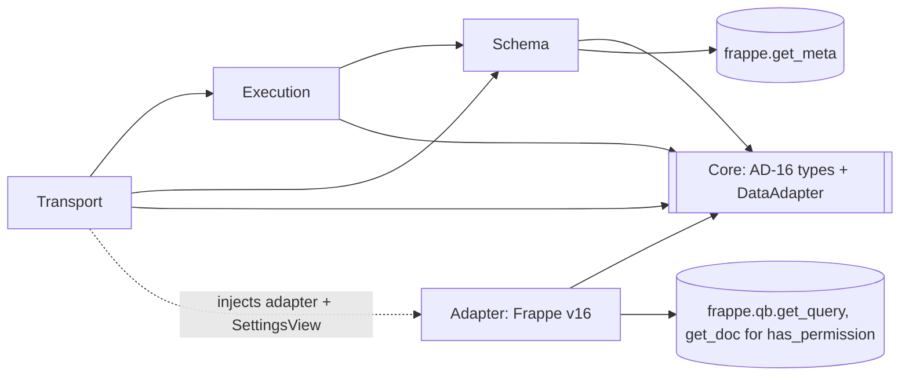
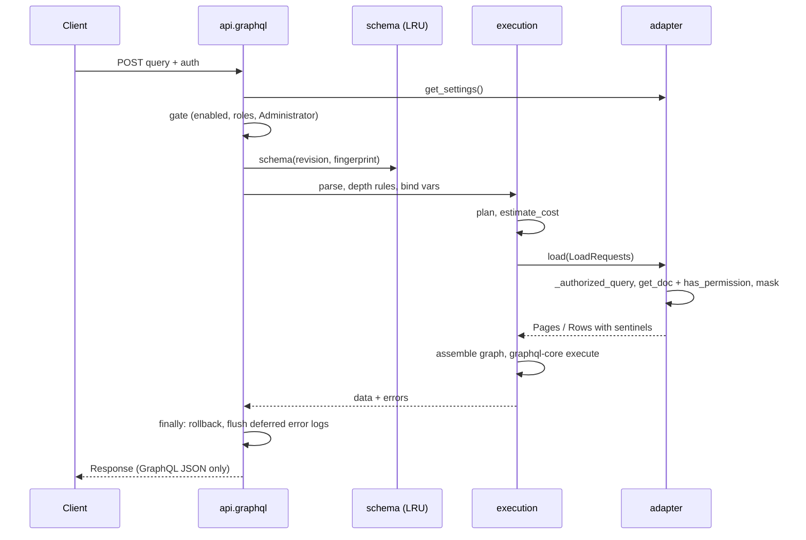
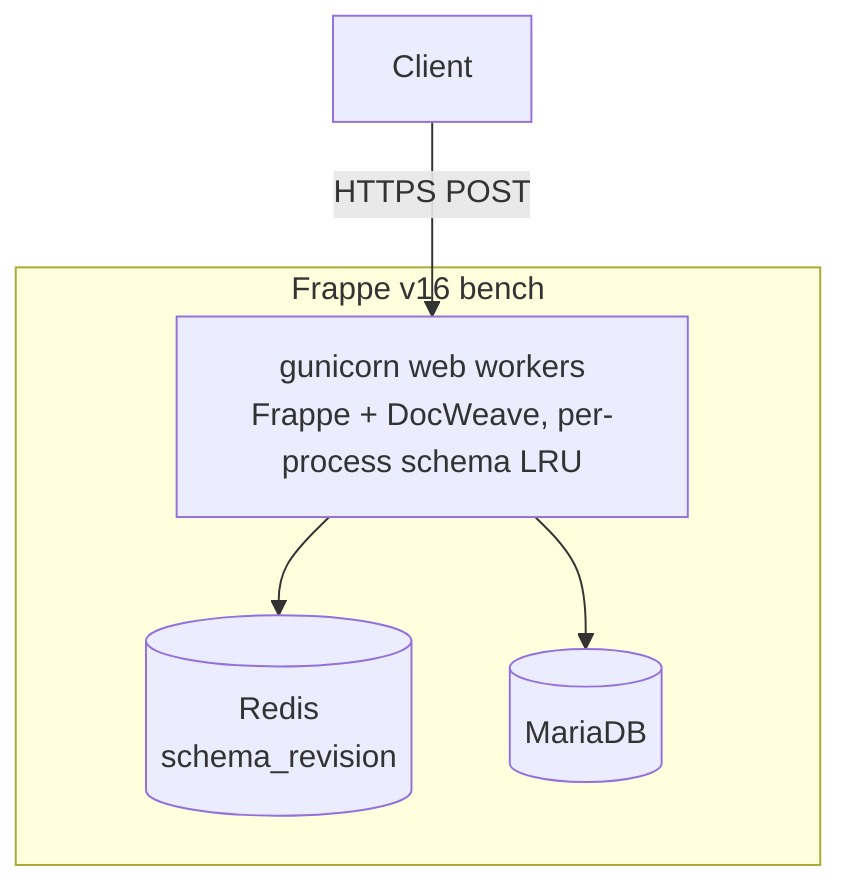

# Architecture Spine: DocWeave v1

**v1 is read-only.** Mutations (FR-11) and the other items under "v2" at the end are out of v1. AD-9 and AD-13 record the agreed v2 design and do not bind v1.

## Design Paradigm

**Hexagonal (ports and adapters), with two-phase execution.** GraphQL is the inbound side and Frappe v16 is the outbound side. A dependency-free **core** owns every type that crosses a layer boundary (AD-16).

| Layer | Package | Owns |
| --- | --- | --- |
| Core (shared kernel) | `docweave/core/` | `types.py` (AD-16 dataclasses, sentinels, `ErrorCode`, `SettingsView`), `port.py` (`DataAdapter`), `resolver.py` (generic resolver), `filter_hash`. Imports nothing from DocWeave or Frappe. |
| Transport | `docweave/api.py` | Endpoints, access gate, read-only guarantee, response writing, wiring (injects adapter and settings) |
| Schema | `docweave/schema/` | Names, fieldtype map, standard fields, building the `GraphQLSchema`, the cache |
| Execution | `docweave/execution/` | Depth rules, planner, cost, result-graph assembly, `graphql-core` execution |
| Adapter | `docweave/adapter/` | The **only** code that touches Frappe data: settings reader, authorized queries, permission checks, masking, cursors, error mapping |
| Configuration | `docweave/docweave/doctype/` | DocWeave Settings (Single) and its child table |



Arrows are the only allowed import directions. `execution` and `schema` never import `adapter`. They receive `SettingsView` and `DataAdapter` from the transport.

## Invariants & Rules

### AD-1: Hexagonal boundary, enforced by allowlist [ADOPTED]

- **Binds:** all, NFR-1
- **Prevents:** data paths that bypass permissions, scattered across layers.
- **Rule:**
  - `docweave/tests/test_boundaries.py` walks every module's AST. `import frappe.x as y` and `from frappe.x import y` are resolved to the same dotted names as attribute access.
  - **Outside `adapter/`** only these names may be used:
    - Everywhere outside `adapter/`: `frappe.get_meta`, `frappe.cache`, `frappe.logger`, `frappe._`, `frappe.session.user`, `frappe.get_roles`, `frappe.utils.get_system_timezone`.
    - In `api.py` only: `frappe.whitelist`, `frappe.local.request`, `frappe.local.message_log`, `frappe.db.rollback`, `frappe.log_error`.
    - In `hooks.py` and `schema/cache.py` only: `frappe.db.after_commit`, `frappe.clear_cache`.
  - **Inside `adapter/`:**
    - Data is read only through `_authorized_query` (AD-2).
    - `adapter/permission.py` may call `frappe.get_doc` and `frappe.has_permission`, solely to evaluate AD-4. Loaded documents never leave that module.
    - `adapter/settings.py` may call `frappe.get_single("DocWeave Settings")` and returns a frozen `core.SettingsView`.
  - **Banned everywhere:** `frappe.db.sql`, `frappe.db.exists`, `frappe.db.get_value`, `frappe.get_all`, `frappe.get_list`, `frappe.get_cached_doc`.

### AD-2: Single authorized read chokepoint [ADOPTED]

- **Binds:** FR-6, FR-7, NFR-1
- **Prevents:** reads under Frappe's `ignore_permissions=True` default.
- **Rule:**
  - Every data read goes through `adapter._authorized_query(doctype, *, fields, filter: FilterIR, order: OrderSpec, after: KeysetPosition | None, limit, parent_doctype=None, parentfield=None, parent_names=None, keys=None)`.
  - It calls `frappe.qb.get_query` with `user=frappe.session.user`, `ignore_permissions=False`, `ignore_user_permissions=False`, then runs the query so that Frappe's masking applies.
  - The parameter set is closed: no `**kwargs`, no raw SQL, no Frappe-format filters from callers.

### AD-3: Two-phase execution; resolvers do no I/O [ADOPTED]

- **Binds:** FR-4, FR-5
- **Prevents:** N+1 queries from nesting, resolvers that fetch data, and merged loads.
- **Rule:**
  - A request runs as: parse, depth rules, bind variables, **plan**, cost check (AD-10), **preload** through `DataAdapter.load`, assemble the result graph, then `graphql-core` executes with `core`'s generic resolver.
  - The generic resolver reads the graph by response key (`info.path.key`) and converts sentinels into errors.
  - **Plan node identity** is `(DocType, parent_doctype, parentfield or link fieldname, argument fingerprint, path from root)`. Batching happens only across sibling parent rows of one node, never across nodes.
  - **Query count.** Nesting adds a constant number of batched queries per plan node, independent of how many parent rows there are. AD-4 permission checks add queries proportional to candidates scanned, bounded by the scan budget.
  - v1 has no `Mutation` root type.

### AD-4: Two-stage authorization with full Frappe parity

- **Binds:** FR-6, FR-8, NFR-1
- **Prevents:** returning documents that Frappe's own REST API would refuse.
- **Rule:**
  - **Stage 1, candidates.** Rows from `_authorized_query`, already filtered by roles, User Permissions on parent links and `permission_query_conditions`.
  - **Stage 2, document check.** For each candidate, `adapter/permission.py` loads the full document with `frappe.get_doc(doctype, name)`, then calls `frappe.has_permission(doctype, "read", doc=doc, user=user)`. That call covers child-row User Permissions, DocShare, `if_owner` and `has_permission` hooks, exactly as Frappe REST does. Loads are cached per request.
  - **Data source.** The returned values always come from the Stage 1 masked row, never from the loaded document.
  - **Select-only users.** A user with `select` but not `read` on the DocType gets an empty connection, or `NOT_FOUND` for a single get, before any scan.
  - **Parity test.** For a fixture matrix (restricted Warehouse on child rows, shared documents, `if_owner`, a hook-denied row), DocWeave results must equal Frappe's own `frappe.get_list` plus per-document `has_permission`.

### AD-5: Masking and unreadable fields are metadata-driven

- **Binds:** FR-7
- **Prevents:** detecting masks by comparing strings, placeholder coercion crashes, null-bubbling, and stale masking after role changes.
- **Rule:**
  - The masked set is the **union** of `meta.get_masked_fields(parenttype=...)` and a fresh per-request computation from the user's current roles via the DocPerm `mask` setting. This means a role revocation takes effect without waiting for Frappe's per-user cache to clear.
  - Readable fields come from Frappe's permitted-fields logic for the user.
  - In `Row`, a masked value becomes `MASKED` and a selected field that is unreadable at its permlevel becomes `FORBIDDEN`. The resolver emits `null` plus that code.
  - **Nullability.** All root fields and every DocType field except `name` are nullable. Inside a connection, `edges`, `node`, `pageInfo` and its booleans are non-null. A child list is `[ChildType!]` and the list itself is nullable. A test runs two aliased connections, one invalid, and asserts that the other still returns data.

### AD-6: No filtering, sorting or derived loads from hidden data

- **Binds:** FR-4, FR-7, FR-8
- **Prevents:** leaking hidden values through filter, sort or link tricks.
- **Rule:**
  - Before any query runs, the adapter rejects with `FORBIDDEN` any `FilterIR` or `OrderSpec` field that is unreadable or masked for the user.
  - A Link (`xDoc`) or child-table load starts only from a source field that is readable and unmasked for that row. Otherwise the derived field gets the same sentinel as its source. `execution/graph.py` sets these derived sentinels from the `Row`.

### AD-7: Links and children are authorized on their own

- **Binds:** FR-4, FR-7
- **Prevents:** inheriting access from a parent, cross-table child leaks, and collation join bugs.
- **Rule:**
  - **Links.**
    - A Link target goes through AD-2 and AD-4 for its own DocType. An unreadable target returns `null` plus `NOT_FOUND`.
    - Empty or NULL Link values give `xDoc: null` with no error and are never sent as keys.
    - The adapter tags each returned `Row` with the key it matched in SQL (`Row.matched_key`). The assembler joins only on that tag, never by comparing Python strings.
  - **Raw names.** The raw `x: String` follows the source field's readability, which matches Frappe desk and REST.
  - **Children.**
    - Child rows load only for parents that passed AD-4, with `parent_doctype`, `parentfield`, and `parent IN (authorized names)`, and only if the Table field is readable at its permlevel.
    - They are ordered by `idx ASC` within each parent.
    - Total child rows per request are capped at Settings `max_child_rows`. Over the cap, the child field fails with `COST_LIMIT` while parent rows still return. Nothing is truncated silently.

### AD-8: Cursor contract [ADOPTED, amended]

- **Binds:** FR-8, FR-9, FR-10
- **Prevents:** stalled pages, skipped or repeated rows, cursor replay, and cursors that leak hidden documents.
- **Rule:**
  - **Encoding.**
    - The cursor uses Fernet authenticated encryption. The key is HKDF-derived from `frappe.utils.password.get_encryption_key()`, with info `docweave-cursor-v1`.
    - The TTL of 24 hours is enforced by `Fernet.decrypt(token, ttl=86400)`.
    - The payload is `{v, doctype, filter_hash, order, user, position}`.
    - A failure to decrypt, an expired token, or a mismatch in user, filter or order returns `BAD_CURSOR`. A change of the site key invalidates all cursors (accepted for v1).
  - **Ordering.**
    - `orderBy` takes **one** field and a direction.
    - The adapter alone appends `name` in the same direction as the tie-break. A missing `orderBy` resolves to `creation DESC`.
    - The resolved order is always encoded in the cursor.
  - **Keyset predicate.** It is written as an explicit OR expansion with `IS NULL` branches, not a row-tuple comparison. NULLs sort first in ASC and last in DESC.
  - **Scanned** means *checked through AD-4*. The adapter fetches candidates in chunks. `position` is the last checked candidate.
  - **Budget.** The scan budget applies per connection occurrence and is never set by the client.
  - **Page info.**
    - Each edge's `cursor` encodes that row's own position. `endCursor` encodes the last **checked** position and may lie beyond the last edge. Clients always continue from `endCursor`.
    - When the budget is exhausted: `scanLimitReached: true`, `hasNextPage: true`, and `endCursor` differs from `after`, which guarantees progress.
    - `hasNextPage` is decided only from checked candidates, never by peeking at an unchecked row. When candidates are known to be exhausted, `hasNextPage` is `false` and `endCursor` is `null`.
    - `first` above the maximum page size is rejected with `VALIDATION`.

### AD-9: Writes go through the Document API, all or nothing [v2]

*The agreed design for v2. Not built or binding in v1.*

- **Binds:** FR-11 (v2)
- **Prevents (v2):** partial commits, skipped validation, and overwriting hidden values.
- **Rule (v2):**
  - Writes use `get_doc().insert()`, `.save()` and `delete_doc` without ignore flags.
  - The transport owns the transaction, with rollback on any mutation error.
  - Update is a sparse patch. Child rows are matched by a verified `name`.
  - The payload is `{ name, doc }`, re-read through the read path.

### AD-10: Request limits

- **Binds:** FR-12
- **Prevents:** unbounded queries, and limit checks that disagree.
- **Rule:**
  - **Depth.** Depth is a `graphql-core` validation rule that counts object-typed field levels only, so `edges` and `node` don't count. `__schema` and `__type` are exempt from it and are bounded instead by graphql-core's `MaxIntrospectionDepthRule`.
  - **Cost.** It is computed once, by `execution.rules.estimate_cost(plan)`, after variables are bound and before any adapter call.
    - `rows(node) = rows(parent) × local(node)`.
    - `local(node)` is `first` for a connection (the maximum page size if omitted), `child_fanout_estimate` for a child table, 1 for a Link or a single get.
    - `cost = Σ rows(node) × scalar leaf fields selected on node`. `__typename` and connection wrappers cost 0.
    - The formula is published in the `Query` type's SDL description.
  - **Breaches** return `DEPTH_LIMIT` or `COST_LIMIT`, and the message names the limit and the value.

### AD-11: Schema is per site, versioned, never per user

- **Binds:** FR-1, FR-2, FR-13, FR-15
- **Prevents:** stale schemas, and per-user or per-language schemas.
- **Rule:**
  - **Contents.** The schema is built from Exposed DocTypes. Descriptions use **untranslated** labels and help text.
  - **Revision.**
    - `docweave:schema_revision` is a Redis integer, created with `SET NX` as a random 63-bit value.
    - It is bumped with `INCR` in `frappe.db.after_commit`, triggered by DocWeave Settings, DocType, Custom Field and Property Setter `doc_events`, and by `after_migrate`.
  - **Cache key.** `(revision, fingerprint)`. The fingerprint hashes:
    - the Settings `modified` timestamp
    - each exposed DocType's and child DocType's meta `modified`
    - Frappe's `metadata_version` cache value, which `frappe.clear_cache` resets when Customize Form or other hook-less paths change metadata

    `metadata_version` is an internal Frappe key and is covered by a test.
  - **Storage.** The built schema lives in a per-process LRU. The previous schema is never served after a revision change.
  - **Failure.** A failed build is logged and returns `INTERNAL`.

### AD-12: Endpoints, access gate, read-only guarantee and response

- **Binds:** FR-2, FR-3, FR-14, PRD §2.2
- **Prevents:** CSRF bypass, guest or portal access, writes, and leaks through Frappe's message envelope.
- **Rule:**
  - **Endpoints.** `docweave.api.graphql` and `docweave.api.sdl` both use `@frappe.whitelist(methods=["POST"])`, with no guests.
  - **Access gate** (in this order):
    1. If Settings `enabled` is off, return 403 `NOT_EXPOSED`.
    2. The user must hold a role in `allowed_roles` (default: desk users; Website Users are never allowed).
    3. Administrator is refused unless `allow_administrator` is on (default off).

    `sdl` uses the same gate as `graphql`.
  - **Settings.** The DocWeave Settings DocType grants read and write to System Manager only and has change tracking on.
  - **Auth.** Frappe native: session with CSRF, API key and secret, or OAuth bearer.
  - **Read-only.**
    - Execution runs inside `try/finally`. The `finally` block calls `frappe.db.rollback()`, then writes any deferred `INTERNAL` log entries with `frappe.log_error(..., defer_insert=True)`. Those entries are collected by `adapter/errors.py` and never written inline.
    - Guarantee: DocWeave issues no writes and discards uncommitted writes made by hooks. Hooks that commit explicitly are out of scope, and this is documented.
  - **Response.**
    - The endpoint returns a werkzeug `Response` containing only the GraphQL JSON, so no Frappe `_server_messages`, `exc` or `message` keys appear.
    - HTTP status is 200 for GraphQL results, including errors. Malformed requests get 400. Gate failures get 403.

### AD-13: Mutation input contract [v2]

*The agreed design for v2. Not built or binding in v1.*

- **Binds:** FR-11 (v2), NFR-1
- **Prevents (v2):** writing protected or system fields, and taking over child rows.
- **Rule (v2):**
  - Input types exclude system, read-only, `fetch_from`, virtual, Password and display fields.
  - Request-time `FORBIDDEN` for fields the user can't write or that are masked.
  - Submitted documents: only `allow_on_submit` fields may change, and delete is refused.

### AD-14: Child DocTypes are never roots

- **Binds:** FR-1, FR-2
- **Prevents:** reading child rows without the parent's check.
- **Rule:**
  - Settings validation rejects `istable=1` DocTypes, Single DocTypes and DocWeave Settings itself. The builder asserts the same.
  - Child types appear only under a parent's Table or Table MultiSelect field.
  - For child rows, AD-4's check is the parent's check.

### AD-15: No existence disclosure; one exception map

- **Binds:** FR-14, NFR-1
- **Prevents:** existence oracles, and divergent error mapping.
- **Rule:**
  - A document unreadable through AD-2 or AD-4 is `NOT_FOUND`, whether or not it exists. `FORBIDDEN` is reserved for fields and filters.
  - **Accepted residual.** `scanLimitReached` can reveal that many hook-rejected documents match a filter range. This is documented.
  - **Exception map.** `adapter/errors.py` is the only mapper:
    - `DoesNotExistError` and `PermissionError` become `NOT_FOUND`.
    - `ValidationError` becomes `VALIDATION`, with the exception class plus a sanitized message.
    - Anything else becomes `INTERNAL`. It is deferred-logged without local variables (`with_context=False`), and no traceback reaches the client.

### AD-16: Port contract

- **Binds:** all units crossing the core boundary
- **Prevents:** incompatible interfaces between execution and adapter.
- **Rule:** `core/types.py` defines these as frozen dataclasses.
  - **`FilterIR`** is `And(children) | Or(children) | Cmp(fieldname, op: FilterOp, value)`.
    - `FilterOp` is `EQ NE IN NIN LT LTE GT GTE LIKE IS_NULL`.
    - Values are typed Python values: `Decimal`, `date`, naive site-time `datetime`, `str`, `int`, `bool`, and tuples for `IN` and `NIN`.
  - **`OrderSpec`** is `OrderKey(fieldname, direction)`, as the client gave it, without the tie-break.
  - **`LoadRequest`** is `(kind: ROOT_ONE | ROOT_CONNECTION | LINK | CHILDREN, doctype, fields: frozenset[fieldname], filter, order, first, after: str | None, keys: tuple[str, ...], parent_doctype, parentfield)`.
  - **`Row`** is a mapping from the **Frappe fieldname** to a value or sentinel.
    - It always includes `name`.
    - Child rows also include `parent`, `parentfield` and `idx`.
    - Link rows include `matched_key`.
    - It never holds GraphQL names.
  - **`Page`** is `(rows, edge_cursors, end_cursor, has_next_page, scan_limit_reached)`.
  - **`SettingsView`** holds the enabled flag, exposed DocTypes, roles, the Administrator flag and every limit.
  - **Cursors** cross the port only as opaque strings. `KeysetPosition` is private to `adapter/cursor.py`.
  - **The port** is `core/port.py`: `DataAdapter.load(requests: Sequence[LoadRequest]) -> Sequence[Page | list[Row]]`, with results aligned to the requests.

## Consistency Conventions

| Concern | Convention |
| --- | --- |
| Names | `schema/naming.py` is the only producer of GraphQL names and of the reverse map to fieldnames. Split on `[^A-Za-z0-9]+` and `_`, lowercase the parts, then capitalize them: all parts for PascalCase types, all but the first for camelCase fields. Prefix `_N` when the result starts with a digit. The root list field is the singular plus `List` (`salesOrderList`). A collision between exposed DocTypes or root fields fails Settings validation **before save**. A field collision drops the custom field, with a logged warning. |
| Standard fields | Every type has `name: String!`, `owner`, `creation`, `modified`, `modifiedBy` and `docstatus`. Child types also have `idx`. These are permlevel 0, never masked, and filterable and orderable. `_*`, `parent`, `parenttype` and `parentfield` are never exposed. |
| Link variants | Link `x` becomes `x: String`, plus `xDoc: <Type>` only if the target is exposed. Dynamic Link `x` becomes `x: String` with no resolved field in v1; its options field appears under its own name. Table and Table MultiSelect become `[ChildType!]`. |
| Fieldtype map | Data, Select, Small Text, Text, Long Text, Text Editor, HTML Editor, Markdown Editor, Code, Read Only, Attach, Attach Image, Color, Barcode, Phone, Autocomplete and Icon become `String`. Int becomes `Int`. Long Int becomes `Long` (serialized as a string). Check becomes `Boolean`. Float, Rating and Duration (seconds) become `Float`. Currency and Percent become `Decimal`. Date, Datetime and Time map to their own scalars. JSON and Geolocation become `JSON`. **Excluded:** Password, Button, HTML, Heading, Image, Section, Column and Tab Break, Fold, Signature, Attachment Gallery. **Unknown fieldtypes** are excluded and logged once per build. |
| Scalars | `Decimal` is `str(value.normalize())`. `Date` is ISO 8601. `Datetime` is output as ISO 8601 with the site offset; on input it is converted to naive site time. `Time` is `HH:MM:SS[.ffffff]`. Scalars use graphql-core 3.3's `coerce_*` hooks. |
| Root fields | `salesOrder(name: String!): SalesOrder` and `salesOrderList(filter: SalesOrderFilter, orderBy: SalesOrderOrder, first: Int, after: String): SalesOrderConnection`. No `Mutation` type in v1. |
| Filter input | `<Type>Filter { and, or, <field>: <ScalarOps> }`. Sibling keys and multiple operators are ANDed. Empty `and` matches all; empty `or` matches none; `in: []` matches none; `nin: []` matches all. `like` works on String only, with `\` as escape. JSON, Text Editor, Markdown Editor, Code and Long Text are not filterable or orderable. `core.filter_hash` is the only hash function: it normalizes Decimals and Datetimes, sorts and deduplicates `IN` values, sorts children, and flattens nested nodes of the same kind. |
| Error codes | `MASKED`, `FORBIDDEN`, `NOT_FOUND`, `NOT_EXPOSED`, `VALIDATION`, `BAD_CURSOR`, `DEPTH_LIMIT`, `COST_LIMIT`, `INTERNAL`, defined only in `core`. |
| Connections | `edges { cursor node }` and `pageInfo { hasNextPage endCursor scanLimitReached }` |
| Config | All limits, exposure, `enabled`, `allowed_roles` and `allow_administrator` live in DocWeave Settings, read only through `adapter/settings.py`. |
| Logging | `frappe.logger("docweave")`. One line per request with duration, query count, candidates scanned, cost and codes. Never field values or cursors. |
| Tests | v16 `IntegrationTestCase` on ERPNext fixtures. Every v1 AD has at least one negative test. Also: the AD-4 parity matrix, the AD-3 query-count test (constant for nesting, linear in candidates), and the AD-5 role-revocation test. |

## Stack

| Name | Version |
| --- | --- |
| Python | 3.14 |
| Frappe Framework | `>=16.53.0,<17`, CI pinned to tag v16.53.0 |
| ERPNext (test-only) | v16.52.1 |
| graphql-core | `~=3.3.0` (3.3 API: `Executor`, frozen AST, `coerce_*` scalars; 3.2 examples don't apply) |
| cryptography (Fernet, HKDF) | `~=50.0.0`, as pinned by Frappe v16 |
| MariaDB | 11.8 |
| Redis | the version Frappe v16 bench provisions |
| frappe-bench | 5.31.0 |
| ruff | 0.14.10 (matches Frappe v16) |
| CI | GitHub Actions with MariaDB and Redis, `allow_tests` on, `bench --site test run-tests --app docweave` |

## Structural Seed

```text
docweave/                         # Frappe app (bench new-app layout, pyproject + flit_core)
  docweave/
    hooks.py                      # doc_events, after_migrate, after_uninstall
    patches.txt
    api.py                        # graphql(), sdl(): gate, try/finally rollback, Response
    core/
      types.py  port.py  resolver.py  filter_hash.py
    schema/
      naming.py  fieldtypes.py  scalars.py  builder.py  cache.py
    execution/
      rules.py  planner.py  graph.py  executor.py
    adapter/
      frappe_v16.py               # DataAdapter impl, _authorized_query, masking
      permission.py               # AD-4 stage 2 (get_doc + has_permission)
      settings.py  cursor.py  errors.py
    docweave/doctype/
      docweave_settings/  docweave_exposed_doctype/
    tests/
      test_boundaries.py  test_access.py  test_schema.py  test_permissions.py
      test_parity.py  test_masking.py  test_pagination.py  test_query_count.py
```





## Operations

- **Deployment:** `bench get-app`, then `bench --site <site> install-app docweave`. It runs inside the existing web workers, with no extra services or jobs. It works self-hosted and on Frappe Cloud. Environments are a devcontainer, CI and the user's site.
- **Release:** semantic versioning. Each release states the exact Frappe v16 and ERPNext tags it was tested on.
- **Upgrade:** `patches.txt` for Settings changes. `after_migrate` bumps `schema_revision`.
- **Uninstall:** `after_uninstall` deletes the `docweave:*` Redis keys.
- **Observability:** the per-request log line, plus deferred `frappe.log_error` for `INTERNAL` errors.

## Capability → Architecture Map

| Capability / Area | Lives in | Governed by |
| --- | --- | --- |
| FR-1 to FR-3: exposure, settings, endpoint | `schema/`, Settings, `adapter/settings.py`, `api.py` | AD-11, AD-12, AD-14 |
| FR-4, FR-5: reads without N+1 | `execution/`, `adapter/` | AD-3, AD-7, AD-16 |
| FR-6: authorized reads | `adapter/frappe_v16.py`, `adapter/permission.py` | AD-1, AD-2, AD-4, AD-15 |
| FR-7: masking | `adapter/`, `core/resolver.py` | AD-5, AD-6 |
| FR-8 to FR-10: pagination | `adapter/cursor.py` | AD-8 |
| FR-12 to FR-15: MCP-readiness | `execution/rules.py`, `schema/`, `api.sdl` | AD-10, AD-11, AD-12, AD-15 |
| NFR-1: security enforcement | `tests/` | AD-1, AD-4 parity test, Tests convention |
| NFR-2: compatibility | CI, Stack | Operations |

## Deferred

- **Child retrieval mechanism:** Frappe's child query or explicit batched loads. AD-7 and AD-14 fix the contract.
- **PostgreSQL:** untested in v1.
- **Rate limiting:** Frappe's limiter and deployment configuration.
- **Redacting raw Link names:** v1 matches Frappe desk (AD-7).
- **Subscriptions and file uploads:** out of v1.
- **Persisted operations:** later. AD-10 covers agent safety.
- **Default limit values:** maximum page 100, scan budget 2,000, depth 8, `child_fanout_estimate` 50, `max_child_rows` 10,000. To be tuned in the first slice. `[ASSUMPTION]`
- **Latency targets for FR-5:** to be set after the first slice. Query-count behaviour is fixed by AD-3.
- **Frappe's built-in MCP (`/api/v2/mcp`):** DocWeave stays a complementary typed, batched read layer. Revisit after v1.

## v2

- **Mutations (FR-11):** AD-9 and AD-13 as recorded above. Submit, cancel, amend and bulk come after that.
- **Cursor key rotation:** a DocWeave-managed key epoch with `MultiFernet` (Frappe keeps a single site key).
- **Multi-field `orderBy`:** multi-key keyset ordering.
- **Schema build lock:** a Redis lock against concurrent builds.
- **Per-request candidate cap:** `max_total_candidates` across connections.
